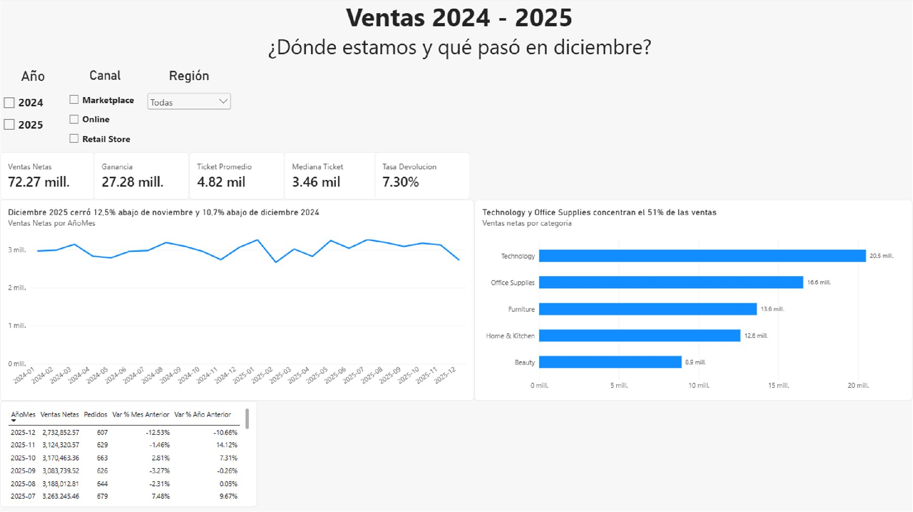
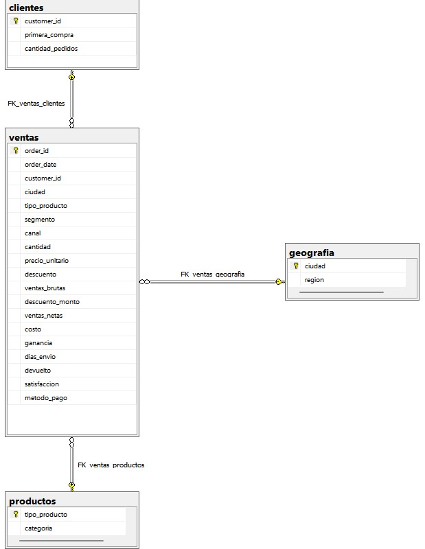
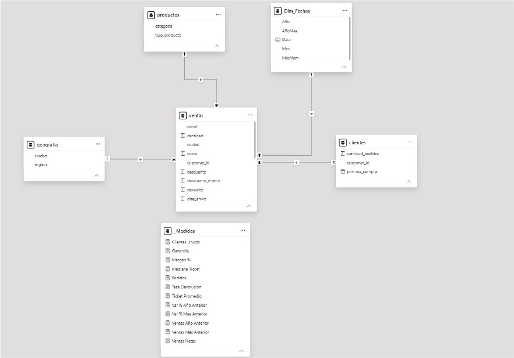

# Análisis de ventas: qué vende, qué rinde y qué se devuelve

Proyecto integrador final del curso de **Data Analytics de Coderhouse** (noviembre 2026).

**Herramientas:** SQL Server · Power Query · DAX · Power BI

## Pregunta de negocio

¿Cómo evolucionaron las ventas de la empresa en 2024 y 2025, qué categorías las sostienen y qué pasó en diciembre de 2025?

Para responderla busco contestar preguntas más chicas:

- ¿Cómo evolucionaron las ventas entre 2024 y 2025?
- ¿Qué categorías, canales y regiones aportan más ventas y más ganancia?
- ¿Qué pasó en diciembre de 2025 frente a noviembre y frente a diciembre de 2024?
- ¿Cuánto representan las devoluciones?
- ¿El ticket promedio es representativo, o lo inflan unos pocos pedidos muy grandes?

**KPIs:** ventas netas, ganancia y margen, cantidad de pedidos, ticket promedio (junto con la mediana) y tasa de devolución.

## Dataset

*Indian Retail Sales Analytics Dataset*, publicado en Kaggle por el usuario vigneshpgd. Es un dataset **sintético** de ventas minoristas: un CSV con 15.000 pedidos y 22 columnas, del 1/1/2024 al 31/12/2025, con importes en rupias (INR). Está en [`data/sales_data.csv`](data/sales_data.csv).

Como es sintético, las conclusiones valen como ejercicio de análisis y no como diagnóstico de una empresa real.

## Cómo lo hice

### 1. Control de calidad en SQL Server

Importé el CSV como `ventas_raw` y revisé filas, duplicados, vacíos, rango de fechas, importes inválidos y coherencia de los totales. Todo cierra salvo la ganancia de 1.095 filas, que son justo los pedidos devueltos (ver el paso 5).

Al importar, el asistente de SQL Server guardó `Product_ID` como dinero y convirtió `P1046` en `1046,00`. Volví a importar la tabla forzando `nvarchar(50)` en esa columna.

### 2. Modelo de datos

Separé `ventas_raw` en un modelo de 4 tablas con claves primarias y foráneas:

| Tabla | Qué representa | Clave | Relación |
|---|---|---|---|
| `clientes` | Código de cliente, primera compra y cantidad de pedidos | `customer_id` | 1 cliente : N ventas |
| `productos` | Tipo de producto (por ejemplo Laptops, Chairs o Makeup) y su categoría | `tipo_producto` | 1 producto : N ventas |
| `geografia` | Ciudad y región | `ciudad` | 1 ciudad : N ventas |
| `ventas` | Un pedido por fila, con fecha, canal, importes y devolución | `order_id` | Lado N de las tres |

`Product_ID` no se usa como clave: el mismo código aparece con distintos precios y categorías, así que no identifica un producto real.

### 3. Consultas SQL

Ejercicio de la consigna: las ventas de los últimos 30 días, contados desde la última fecha del dataset (31/12/2025). Devuelve 607 pedidos.

### 4. Validación estadística del ticket

La media (4.818) está un 39% por encima de la mediana (3.463). Con el método IQR hay 875 pedidos atípicos (5,8%) que concentran el 22,5% de las ventas netas. No son errores: son pedidos grandes legítimos. Por eso el dashboard muestra la mediana junto al promedio.

### 5. Devoluciones y ganancia

En los pedidos devueltos, la ganancia del dataset es el 72% de la esperada (1,50 M contra 2,09 M). Es una regla del dataset sintético, sin documentar.

**Decisión:** dejé las cifras como vienen y lo aclaro. Si la ganancia se calculara como ventas netas menos costo, el margen sería de 38,6% en vez de 37,7%. La diferencia no cambia ninguna conclusión.

### 6. Power Query, modelo en estrella y DAX

En Power Query revisé los tipos de datos y cambié `devuelto` a número entero. Activé el perfil de columnas sobre todo el conjunto: no hay errores ni vacíos.

En Power BI armé un modelo en estrella: `ventas` en el centro, las tres dimensiones y una tabla calendario `Dim_Fechas`. Las medidas están en la tabla `_Medidas` ([`dashboard/medidas_DAX.dax`](dashboard/medidas_DAX.dax)).

Validé el modelo contra SQL: las ventas netas dan 72.271.513,68 en los dos.

### 7. Dashboard

El dashboard se lee en Z:
- **Arriba:** filtros por año, canal y región.
- **Debajo de los filtros:** cinco tarjetas de KPIs.
- **Al medio:** la tendencia mensual y las ventas por categoría.
- **Abajo:** una tabla con la variación contra el mes y el año anterior.

Cada título de gráfico dice la conclusión, no solo qué se mide.

## Principales hallazgos

| Indicador | Valor |
|---|---|
| Ventas netas | 72,27 M INR |
| Ganancia | 27,28 M INR (margen 37,7%) |
| Crecimiento de ventas netas 2025 vs 2024 | +2,6% |
| Tasa de devolución | 7,3% de los pedidos |
| Ticket promedio / mediana | 4.818 / 3.463 |

1. **Las ventas son estables y crecen poco:** +2,6%, sobre todo por más pedidos.
2. **Tecnología vende más, pero no es la que más gana:**
   - Tecnología aporta el 28,4% de las ventas con el margen más bajo (31,2%).
   - Office Supplies gana más con menos ventas (margen 42,0%).
3. **Online concentra el 57,7% de las ventas.** Los tres canales tienen el mismo margen.
4. **Las regiones se diferencian por volumen, no por precio.** El ticket y el margen son casi iguales en las cinco.
5. **Las devoluciones son parejas:** entre 6,7% y 7,9% en todos los canales y categorías.
6. **El ticket promedio no representa a un pedido típico.** Conviene mirarlo junto con la mediana.
7. **Diciembre de 2025 cerró 12,5% por debajo de noviembre y 10,7% por debajo de diciembre de 2024.** Es un solo mes y no alcanza para hablar de tendencia.

El detalle, las recomendaciones y las preguntas teóricas están en el [informe completo (PDF)](informe/Proyecto_Final_Timpanaro_Eduardo.pdf).

## Contenido del repositorio

| Carpeta | Qué hay |
|---|---|
| [`sql/`](sql) | Scripts de SQL Server numerados en orden de ejecución |
| [`dashboard/`](dashboard) | Dashboard de Power BI (`.pbix`) y medidas DAX |
| [`informe/`](informe) | Informe final en PDF |
| [`data/`](data) | Dataset original en CSV |
| [`img/`](img) | Dashboard, diagrama ER y modelo de Power BI |

## Cómo reproducirlo

1. Crear la base `ProyectoFinal` en SQL Server e importar `data/sales_data.csv` como `dbo.ventas_raw`. `Product_ID` tiene que quedar como texto.
2. Ejecutar los scripts de `sql/` en orden:

| Script | Qué hace |
|---|---|
| `00_control_calidad_ventas_raw.sql` | Controles sobre la tabla original |
| `01_modelo_tablas.sql` | Crea y carga las 4 tablas, y controla los conteos |
| `02_renombrar_claves_foraneas.sql` | Deja los nombres finales (`productos`, `tipo_producto`) y nombra las claves foráneas |
| `03_ventas_ultimos_30_dias.sql` | Ejercicio de la consigna: ventas de los últimos 30 días |
| `04_conteo_ventas_ultimos_30_dias.sql` | Conteo de esas ventas (607) |
| `05_validacion_estadistica_ticket.sql` | Media, mediana, IQR y pedidos atípicos |
| `06_devoluciones_vs_ganancia.sql` | Ganancia esperada contra la del dataset |
| `07_validacion_power_bi.sql` | Totales para comparar con Power BI |

3. Abrir `dashboard/Dashboard_Ventas.pbix` con Power BI Desktop y, si hace falta, apuntar el origen de datos a tu servidor.

## Autor

Eduardo Timpanaro
